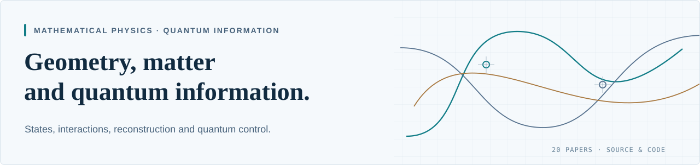

# AI-Automated Quantum Gravity Research

**20 English papers · Editable sources · Portable calculations and saved results**

Positive physical states for coupled fields, quantitative geometry–matter information protocols, exact finite constructions, and mathematical methods for reconstruction and quantum control.

**[Browse all 20 papers](docs/PAPER-INDEX.md) · [Explore the research map](docs/RESEARCH-MAP.md) · [Run a calculation](docs/REPRODUCTION.md) · [Workflow and credit](DECLARATIONS.md)**

## Research highlights

| Result | What to read |
|---|---|
| **Canonical coupled Hadamard states.** Positive gauge-invariant quasifree states for linearized Einstein gravity with a finite positive scalar multiplet, on the stated critical backgrounds with compact Cauchy surface. Nonconstant flat-direction backgrounds are included. | [09 · PDF](papers/09-canonical-einstein-scalar-hadamard/manuscript.pdf) · [Proof and algebra](papers/09-canonical-einstein-scalar-hadamard/README.md) |
| **Geometry-mediated quantum information.** A heralded DBI controlled-phase gate, autonomous Maxwell entanglement with positive-energy local clocks, and an energy-weighted JT recovery estimate answer three different information tasks. | [04 · DBI gate](papers/04-dbi-heralded-controlled-phase/manuscript.pdf) · [06 · Maxwell clocks](papers/06-maxwell-local-clocks/manuscript.pdf) · [03 · JT recovery](papers/03-jt-energy-weighted-recovery/manuscript.pdf) |
| **Finite control and network proliferation.** Explicit four-level controls exhibit exceptional two-cell pairing, while the specified independently controlled connected networks generate the full algebra for three or more cells. | [10 · PDF](papers/10-quantum-weight-networks/manuscript.pdf) · [Construction and checks](papers/10-quantum-weight-networks/README.md) |
| **Reconstruction and moment methods.** Generic real projection signs are recovered from two-point data; regulated and thermal moment problems give explicit determinacy, escape and reconstruction-limit results. | [01 · Projection recovery](papers/01-projection-sign-rigidity/manuscript.pdf) · [12 · Moment/corona limits](papers/12-complexity-moment-corona/manuscript.pdf) · [13 · Thermal statistics](papers/13-thermal-statistics-reconstruction/manuscript.pdf) |
| **Coupled interactions and finite geometry.** A native off-shell Einstein–scalar quartic, an exact split-signature matter-supported solution, and explicit Cartan–Regge certificates make the relevant constructions inspectable. | [08 · Interactions](papers/08-einstein-scalar-mixed-quartic/manuscript.pdf) · [17 · Finite closure](papers/17-cartan-regge-closure/manuscript.pdf) · [11 · Causal transfer](papers/11-causal-regge-transfer/manuscript.pdf) |
| **Integer flux families.** Exact STU solutions have positive complex-structure/axiodilaton masses and explicit charge–coupling relations within the constructed family. | [05 · PDF](papers/05-integer-flux-families/manuscript.pdf) · [Exact calculation](papers/05-integer-flux-families/README.md) |

The [paper index](docs/PAPER-INDEX.md) gives the question, result, model and evidence for every manuscript. Numbers identify delivery packets, not a ranking of importance or a count of the wider source corpus.

## Choose a reading route

| Interest | Papers |
|---|---|
| Quantum channels, gates and control | [03 · JT](papers/03-jt-energy-weighted-recovery/) · [04 · DBI](papers/04-dbi-heralded-controlled-phase/) · [06 · Maxwell](papers/06-maxwell-local-clocks/) · [10 · Networks](papers/10-quantum-weight-networks/) |
| Coupled states, stability and interactions | [09 · Canonical states](papers/09-canonical-einstein-scalar-hadamard/) · [07 · Reference effective model](papers/07-clock-foliated-reference/) · [08 · Quartic/backreaction](papers/08-einstein-scalar-mixed-quartic/) · [19 · Local gauge benchmark](papers/19-local-gauge-benchmarks/) |
| Probability, moments and reconstruction | [01 · Projection signs](papers/01-projection-sign-rigidity/) · [02 · Wiener chaos](papers/02-half-wormholes-wiener-chaos/) · [12 · Regulator limits](papers/12-complexity-moment-corona/) · [13 · Thermal laws](papers/13-thermal-statistics-reconstruction/) |
| Operational geometry and finite carriers | [14 · Instruments](papers/14-operational-instrument-geometry/) · [15 · Cartan carriers](papers/15-positive-cartan-carriers/) · [16 · Fuzzy oscillator](papers/16-fuzzy-half-turn-limits/) |
| Discrete geometry and integer data | [05 · STU flux](papers/05-integer-flux-families/) · [17 · Cartan–Regge closure](papers/17-cartan-regge-closure/) · [11 · Causal Regge transfer](papers/11-causal-regge-transfer/) |
| Boundary compatibility and research methods | [18 · Positive sewing](papers/18-positive-boundary-sewing/) · [19 · Gauge benchmark](papers/19-local-gauge-benchmarks/) · [20 · Research case study](papers/20-ai-research-case-study/) |

The connections are scientific reading routes across distinct models. The [research map](docs/RESEARCH-MAP.md) explains their common methods and their separate hypotheses.

### Canonical states and the reference effective model

[Paper 09](papers/09-canonical-einstein-scalar-hadamard/) proves a physical Hadamard-state existence theorem for the **canonical** coupled Einstein–scalar system under its compact-Cauchy and critical-potential assumptions. [Paper 07](papers/07-clock-foliated-reference/) changes the action with preferred-clock terms, controls its inhomogeneous quadratic spectrum and constructs a finite-band Gaussian. Its modified propagation characteristics require a separate continuum state analysis. The two papers address different questions.

## Reproduce a result

Every current packet has a local README, useful calculation files and a verification record. A short exact example, using only Python's standard library, checks the corrected projection-fibre example:

~~~powershell
cd papers/01-projection-sign-rigidity
python verification/check_revision.py
~~~

For a symbolic or numerical calculation, choose a row in the [twenty-paper reproduction guide](docs/REPRODUCTION.md) and install that packet's requirements. The guide distinguishes fresh calculations, saved-certificate replays and optional heavy producers.

With TeX Live and latexmk installed, rebuild one manuscript from the repository root:

~~~powershell
./tools/build.ps1 -Paper 09-canonical-einstein-scalar-hadamard
~~~

[Verification and evidence](VERIFICATION.md) explains how analytical proofs, exact algebra, numerical estimates and retained inputs support the claims.

## Current editions

Papers 01 and 02 are the corrected 29 October 2026 editions. Their earlier PDFs and sources remain available in the [projection edition history](papers/01-projection-sign-rigidity/EDITION-HISTORY.md) and [chaos edition history](papers/02-half-wormholes-wiener-chaos/EDITION-HISTORY.md).

[Manuscript status](MANUSCRIPT-STATUS.md) maps combined source versions to the completed articles and identifies the precise stronger claims that still require proof. [History](HISTORY.md) records the scientific deliveries and version policy.

## An AI-led research workflow

The workflow asks AI systems to survey literature, select questions, develop candidate solutions, perform derivations and computations, and cross-review the results. Human direction sets priorities, supplies feedback and decides what enters the archive.

The operator reports that earlier work was led mainly by **Fable 5**, while results from **July 2026 onward were predominantly produced by GPT models**. **DeepSeek and multiple GPT models** also contributed cross-review, checking and manuscript preparation.

> I genuinely do not know how authorship, intellectual credit, or ownership should be attributed for these results.

Human author and affiliation fields remain blank. Human expert review has not yet occurred. [Workflow, credit and review](DECLARATIONS.md) gives the accepted disclosure and unresolved rights status.

## Archive guide

| Location | Purpose |
|---|---|
| [Paper index](docs/PAPER-INDEX.md) | All twenty questions, results, scopes and artifact links |
| [Research map](docs/RESEARCH-MAP.md) | Themes, connections and reading routes |
| [Reproduction guide](docs/REPRODUCTION.md) | Setup, exact commands, outputs and optional producers |
| [Verification](VERIFICATION.md) | Evidence types and paper-specific records |
| [Verification history](docs/VERIFICATION-HISTORY.md) | Preserved scientific-delivery coverage |
| [History](HISTORY.md) | Source dates, deliveries and revised editions |
| [Manuscript status](MANUSCRIPT-STATUS.md) | Source consolidation and unresolved stronger targets |
| [Declarations](DECLARATIONS.md) | Contribution history, authorship, review and rights |

This repository is a public research archive. A completed packet is an inspectable scientific artifact; journal publication and demonstrated public disclosure are separate events.
