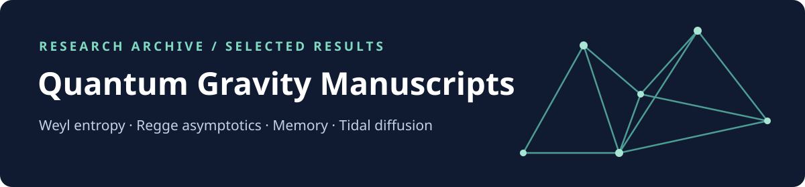

# Selected Quantum Gravity Manuscripts

**Four supplemental technical manuscripts** · [Main research archive](../README.md)

> These are research drafts with explicit mathematical hypotheses and AI-assisted derivations and cross-checks. They are not peer-reviewed publications or claims of a complete quantum gravity theory. Read the scope of each result together with its statement.

| Manuscript | Result | Scope |
|---|---|---|
| [Coherent relative entropy of the Weyl algebra](weyl-diamond-relative-entropy.md) | An explicit gauge-invariant diamond quadratic form and a finite-jet locality obstruction. | Coherent states of the free linearized Weyl algebra in four-dimensional Minkowski space. |
| [Airy asymptotics of a Lorentzian Regge degeneracy](lorentzian-regge-airy.md) | A concrete coalescence, nonzero cubic and uniform real-contour Airy asymptotics. | One marked Lorentzian 4–2 circuit on its stated causal branch; no global contour claim. |
| [A boost obstruction for spin-two memory infravacua](gravitational-memory-boost.md) | Finite-energy memory representations coexist with a standard-boost obstruction in the tested class. | Shell-flat quasifree representations; not a general failure of Lorentz symmetry. |
| [Calibrated tidal diffusion in de Sitter](calibrated-tidal-diffusion.md) | A freely falling tracefree tidal record with fixed finite aperture has a controlled nonzero diffusion scale. | Linear Einstein gravitons in the Bunch–Davies state and the specified calibration. |

These manuscripts supplement, rather than renumber, the [original twenty-paper collection](../docs/PAPER-INDEX.md). See the archive's [declarations](../DECLARATIONS.md) for workflow, credit and review status.
